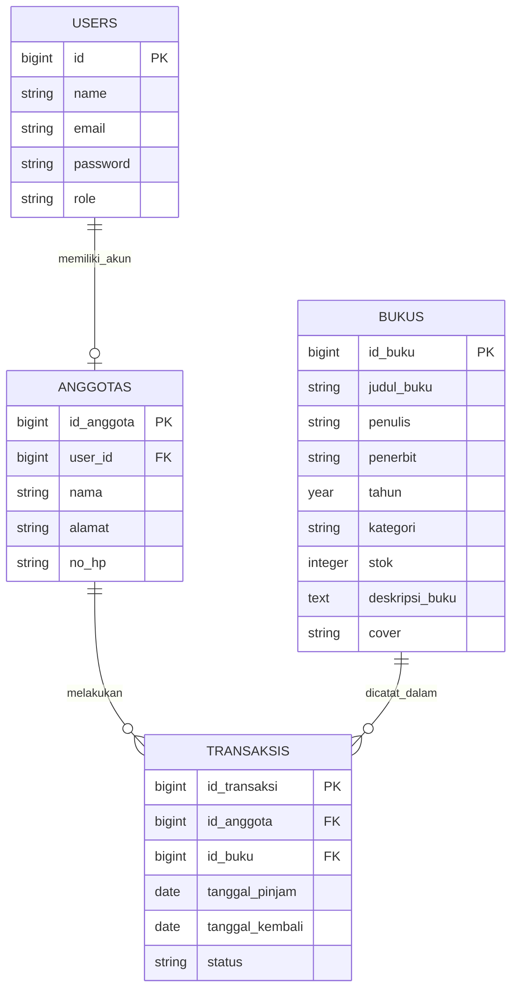
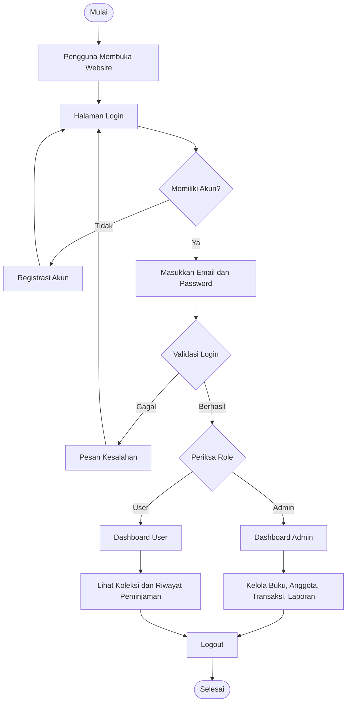
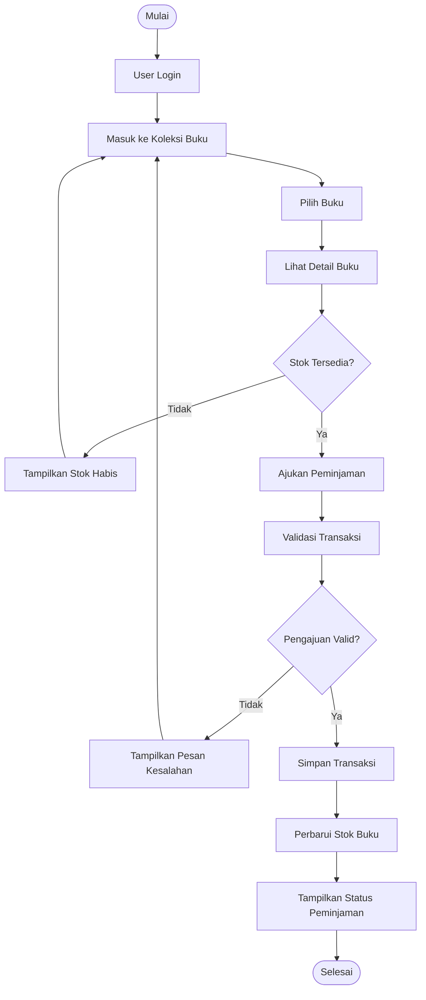
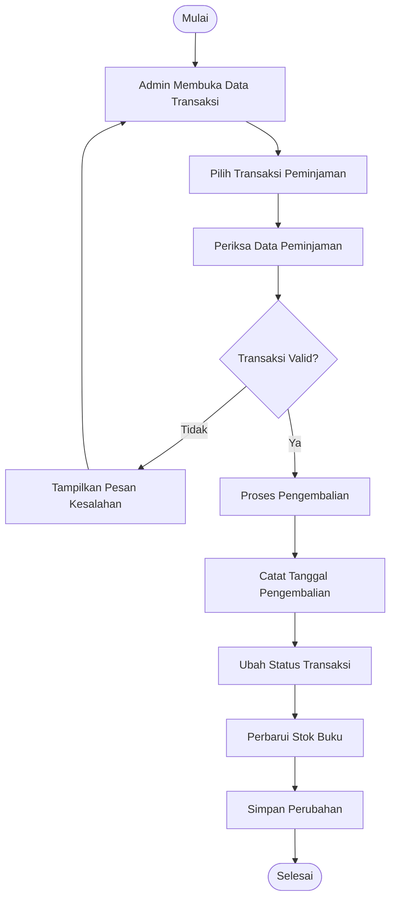

# 📚 PERPUSTAKAAN DIGITAL UKK EGA

<p align="center">
  <strong>Sistem Informasi Manajemen Perpustakaan Digital</strong><br>
  Aplikasi Pengelolaan Data Buku, Anggota, Peminjaman, dan Pengembalian Buku
</p>

<p align="center">
  
  
  
  
</p>

<p align="center">
  <a href="https://zegantaa.github.io/perpustakaanUKK_ega/">🌐 Kunjungi Website</a>
</p>

---

## 📖 1. Tentang Proyek

**Perpustakaan Digital UKK EGA** merupakan aplikasi berbasis web yang dikembangkan untuk membantu proses pengelolaan administrasi dan operasional perpustakaan secara digital.

Aplikasi ini dirancang untuk mempermudah petugas perpustakaan dalam mengelola koleksi buku, data anggota, transaksi peminjaman, pengembalian, serta laporan sirkulasi perpustakaan.

Selain menyediakan fasilitas pengelolaan untuk administrator, aplikasi ini juga dirancang agar pengguna dapat mengakses koleksi buku, melakukan proses peminjaman, dan melihat riwayat transaksi melalui akun masing-masing.

Dengan sistem pengelolaan berbasis digital, proses administrasi perpustakaan diharapkan menjadi lebih terstruktur, efisien, akurat, dan mudah digunakan.

### 🎯 Tujuan Pengembangan

1. Mendigitalisasi proses administrasi perpustakaan.
2. Mempermudah pengelolaan data buku dan anggota.
3. Mempercepat proses pencatatan peminjaman dan pengembalian.
4. Mengurangi risiko kesalahan pencatatan secara manual.
5. Menyediakan informasi koleksi buku secara terstruktur.
6. Mempermudah pemantauan transaksi dan riwayat peminjaman.
7. Menyediakan laporan sirkulasi perpustakaan.

---

## 🌐 2. Informasi Proyek

| Informasi | Keterangan |
|---|---|
| Nama Aplikasi | Perpustakaan Digital UKK EGA |
| Jenis Aplikasi | Sistem Informasi Perpustakaan Berbasis Web |
| Kategori | Web Application |
| Framework | Laravel 10 |
| Versi Laravel | 10.50.3 |
| Bahasa Pemrograman | PHP |
| Versi PHP | 8.1 atau lebih baru |
| Database | MySQL |
| Frontend | HTML, CSS, JavaScript, Blade |
| Build Tool | Vite |
| Penyimpanan Cover | Cloudinary |
| Platform Repository | GitHub |
| Hosting Demo | GitHub Pages |

**Website:**  
https://zegantaa.github.io/perpustakaanUKK_ega/

---

## ✨ 3. Fitur dan Modul Aplikasi

### 👨‍💻 A. Administrator

Administrator memiliki akses untuk mengelola dan memantau seluruh data operasional perpustakaan.

#### 1. Dashboard Admin
- Menampilkan ringkasan informasi perpustakaan.
- Menampilkan statistik data buku.
- Menampilkan informasi anggota.
- Menampilkan ringkasan transaksi peminjaman.
- Mempermudah administrator memantau aktivitas perpustakaan.

#### 2. Manajemen Data Buku
- Menampilkan seluruh koleksi buku.
- Menambahkan data buku baru.
- Mengedit informasi buku.
- Menghapus data buku.
- Mengunggah gambar cover buku.
- Mengelola stok buku.
- Mengelompokkan buku berdasarkan kategori.
- Mencari buku berdasarkan judul, penulis, dan kategori.

Informasi buku meliputi:
- Judul buku.
- Penulis.
- Penerbit.
- Tahun terbit.
- Kategori.
- Stok.
- Deskripsi buku.
- Cover buku.

#### 3. Manajemen Data Anggota
- Menampilkan daftar anggota perpustakaan.
- Menambahkan anggota baru.
- Mengedit data anggota.
- Menghapus data anggota.
- Mengelola informasi keanggotaan.

#### 4. Manajemen Transaksi
- Menampilkan data transaksi peminjaman.
- Menambahkan transaksi peminjaman.
- Mengedit informasi transaksi.
- Menghapus transaksi.
- Mengelola proses pengembalian buku.
- Memantau status transaksi.

#### 5. Laporan Perpustakaan
- Menampilkan laporan peminjaman.
- Menampilkan laporan pengembalian.
- Memantau aktivitas sirkulasi buku.
- Membantu administrator mengevaluasi aktivitas perpustakaan.

#### 6. Manajemen User
- Mengelola akun pengguna.
- Menambahkan akun pengguna.
- Mengatur akses pengguna sesuai peran sistem.

### 👤 B. User / Anggota

Pengguna dapat memanfaatkan aplikasi untuk memperoleh informasi koleksi buku dan mengakses aktivitas peminjaman.

#### 1. Dashboard User
Menampilkan informasi utama dan ringkasan aktivitas pengguna.

#### 2. Koleksi Buku
- Melihat daftar koleksi buku.
- Melihat informasi detail buku.
- Melihat cover buku.
- Mengetahui ketersediaan stok buku.

#### 3. Peminjaman Buku
- Memilih buku yang ingin dipinjam.
- Mengajukan peminjaman.
- Melihat informasi transaksi peminjaman.

#### 4. Riwayat Peminjaman
- Melihat daftar peminjaman.
- Melihat status transaksi.
- Memantau informasi pengembalian buku.

---

## 🛠️ 4. Teknologi yang Digunakan

| Teknologi | Fungsi |
|---|---|
| Laravel 10.50.3 | Framework backend aplikasi |
| PHP 8.1+ | Bahasa pemrograman backend |
| MySQL | Sistem manajemen basis data |
| HTML5 | Struktur halaman web |
| CSS3 | Desain dan tata letak |
| JavaScript | Interaksi pada halaman web |
| Blade Template | Template engine Laravel |
| Vite | Pengelolaan dan kompilasi aset frontend |
| Cloudinary | Penyimpanan gambar cover buku |
| Git | Version control |
| GitHub | Penyimpanan repository kode |

---

## 🗄️ 5. Struktur Database

Database dirancang untuk menyimpan informasi yang berhubungan dengan pengelolaan perpustakaan.

### Tabel Utama

**1. bukus**

Menyimpan informasi koleksi buku perpustakaan.

| Kolom | Keterangan |
|---|---|
| id_buku | Primary Key |
| judul_buku | Judul buku |
| penulis | Nama penulis |
| penerbit | Nama penerbit |
| tahun | Tahun terbit |
| kategori | Kategori buku |
| stok | Jumlah stok buku |
| deskripsi_buku | Deskripsi buku |
| cover | URL gambar cover |

**2. users**

Menyimpan informasi akun pengguna aplikasi, termasuk administrator dan user sesuai sistem autentikasi.

**3. anggotas**

Entitas data anggota perpustakaan yang digunakan untuk menyimpan informasi keanggotaan.

**4. transaksis**

Menyimpan informasi transaksi peminjaman dan pengembalian buku serta hubungan dengan data buku dan anggota.

> Catatan: Nama tabel, atribut, dan foreign key untuk entitas users, anggotas, dan transaksis pada diagram berikut merupakan rancangan konseptual. Sesuaikan dengan migration dan database aktual sebelum dianggap sebagai skema final.

---

## 🔗 6. Entity Relationship Diagram (ERD)

ERD menggambarkan hubungan antarentitas yang digunakan dalam sistem informasi Perpustakaan Digital UKK EGA.



### Penjelasan Relasi ERD

1. **Users – Anggotas:** Satu akun dapat dikaitkan dengan data keanggotaan.
2. **Anggotas – Transaksis:** Satu anggota dapat melakukan beberapa transaksi peminjaman.
3. **Bukus – Transaksis:** Satu buku dapat tercatat dalam beberapa transaksi pada waktu yang berbeda.

### Fungsi ERD

- Menggambarkan struktur penyimpanan data.
- Memperjelas hubungan antarentitas.
- Membantu proses perancangan database.
- Mengurangi risiko duplikasi data.
- Mempermudah pengembangan aplikasi.

---

## 🔄 7. Flowchart Sistem

Flowchart berikut menjelaskan alur kerja umum sistem Perpustakaan Digital UKK EGA dari proses login hingga pengelolaan transaksi.

### A. Flowchart Utama Sistem



### B. Flowchart Peminjaman Buku



### C. Flowchart Pengembalian Buku



---

## 📁 8. Struktur Direktori Laravel

Berikut gambaran struktur direktori utama proyek:

```text
perpustakaanUKK_ega/
│
├── app/
│   ├── Http/
│   │   └── Controllers/
│   │       └── BukuController.php
│   └── Models/
│       └── Buku.php
│
├── bootstrap/
│
├── config/
│   └── services.php
│
├── database/
│   ├── migrations/
│   └── seeders/
│
├── public/
│   ├── build/
│   ├── images/
│   └── index.php
│
├── resources/
│   ├── css/
│   ├── js/
│   └── views/
│       ├── buku/
│       ├── admin/
│       └── user/
│
├── routes/
│   └── web.php
│
├── storage/
│
├── tests/
│
├── .env.example
├── artisan
├── composer.json
├── package.json
└── README.md
```

*Struktur di atas merupakan gambaran direktori utama, bukan daftar seluruh file aktual.*

---

## ⚙️ 9. Instalasi dan Konfigurasi

Untuk menjalankan proyek pada komputer lokal, ikuti langkah berikut.

### Persyaratan Sistem

- PHP 8.1 atau lebih baru.
- Composer.
- MySQL.
- Node.js dan NPM.
- Git.
- Web server yang mendukung Laravel.

### Langkah 1 — Clone Repository

```bash
git clone https://github.com/USERNAME/perpustakaanUKK_ega.git
```

Masuk ke direktori proyek:

```bash
cd perpustakaanUKK_ega
```

### Langkah 2 — Instalasi Dependency

```bash
composer install
```

Instalasi dependency frontend:

```bash
npm install
```

### Langkah 3 — Konfigurasi Environment

Salin file environment:

```bash
cp .env.example .env
```

Pada Windows PowerShell:

```powershell
Copy-Item .env.example .env
```

### Langkah 4 — Generate Application Key

```bash
php artisan key:generate
```

### Langkah 5 — Konfigurasi Database

Buat database MySQL dengan nama:

```text
perpustakaan_ega
```

Kemudian sesuaikan konfigurasi `.env`:

```env
APP_NAME="Perpustakaan Digital UKK EGA"
APP_ENV=local
APP_KEY=
APP_DEBUG=true
APP_URL=http://localhost

DB_CONNECTION=mysql
DB_HOST=127.0.0.1
DB_PORT=3306
DB_DATABASE=perpustakaan_ega
DB_USERNAME=root
DB_PASSWORD=
```

Sesuaikan username dan password dengan konfigurasi MySQL masing-masing.

### Langkah 6 — Migrasi Database

```bash
php artisan migrate
```

Jika proyek menyediakan seeder:

```bash
php artisan db:seed
```

### Langkah 7 — Build Frontend

```bash
npm run build
```

### Langkah 8 — Jalankan Aplikasi

```bash
php artisan serve
```

Buka browser:

```text
http://127.0.0.1:8000
```

---

## ☁️ 10. Integrasi Cloudinary

Aplikasi menggunakan Cloudinary untuk membantu penyimpanan gambar cover buku secara online.

### Fungsi Integrasi

- Mengunggah cover buku.
- Menyimpan gambar pada penyimpanan cloud.
- Menghasilkan URL gambar yang dapat diakses secara online.
- Menghapus gambar lama ketika cover diperbarui atau buku dihapus.

### Folder Penyimpanan

```text
perpustakaan/
└── covers/
    ├── cover-buku-1
    ├── cover-buku-2
    └── cover-buku-3
```

### Konfigurasi Environment

Tambahkan konfigurasi berikut ke file `.env`:

```env
CLOUDINARY_CLOUD_NAME=your_cloud_name
CLOUDINARY_API_KEY=your_api_key
CLOUDINARY_API_SECRET=your_api_secret
```

**Keamanan:** Jangan pernah mengunggah file `.env` atau membagikan API Secret Cloudinary ke repository publik.

---

## 🔐 11. Keamanan Sistem

Beberapa aspek keamanan yang perlu diterapkan dalam aplikasi:

1. Autentikasi pengguna menggunakan sistem login.
2. Pembatasan akses berdasarkan role administrator dan user.
3. Validasi input sebelum data disimpan.
4. Perlindungan terhadap akses halaman yang tidak memiliki izin.
5. Penggunaan hashing untuk penyimpanan password.
6. Pengelolaan konfigurasi rahasia melalui environment.
7. Validasi format dan ukuran file cover.
8. Penggunaan CSRF protection pada formulir Laravel.

---

## 📊 12. Manfaat Aplikasi

| No. | Manfaat | Penjelasan |
|---|---|---|
| 1 | Efisiensi | Mempercepat pengelolaan administrasi perpustakaan |
| 2 | Akurasi | Membantu mengurangi kesalahan pencatatan |
| 3 | Kemudahan | Mempermudah pencarian informasi buku |
| 4 | Pengawasan | Mempermudah pemantauan transaksi |
| 5 | Dokumentasi | Menyimpan riwayat peminjaman |
| 6 | Pelaporan | Membantu penyusunan laporan sirkulasi |

---

## 🚀 13. Pengembangan Selanjutnya

Beberapa pengembangan yang dapat dilakukan untuk meningkatkan kualitas aplikasi:

- Notifikasi jatuh tempo pengembalian.
- Perhitungan denda keterlambatan.
- Cetak laporan dalam format PDF.
- Ekspor data ke Excel.
- Barcode atau QR Code buku.
- Dashboard statistik yang lebih interaktif.
- Notifikasi peminjaman secara real-time.
- Penyempurnaan tampilan responsif untuk perangkat mobile.
- Pengujian keamanan dan performa aplikasi.

---

## 🧪 14. Pengujian Aplikasi

Pengujian dilakukan untuk memastikan fungsi utama aplikasi berjalan sesuai kebutuhan.

| No. | Modul | Skenario Pengujian |
|---|---|---|
| 1 | Login | Memasukkan email dan password |
| 2 | Registrasi | Membuat akun baru |
| 3 | Dashboard | Membuka halaman sesuai role |
| 4 | Buku | Menambah, mengedit, menghapus buku |
| 5 | Anggota | Menambah, mengedit, menghapus anggota |
| 6 | Transaksi | Membuat dan mengelola peminjaman |
| 7 | Pengembalian | Memproses pengembalian buku |
| 8 | Koleksi | Menampilkan dan mencari buku |
| 9 | Riwayat | Menampilkan riwayat peminjaman |
| 10 | Laporan | Menampilkan data laporan |

---

## 📌 15. Status Proyek

| Komponen | Keterangan |
|---|---|
| Pengembangan Backend | Laravel 10 |
| Database | MySQL |
| Pengelolaan Buku | Modul yang dikembangkan |
| Pengelolaan Cover | Integrasi Cloudinary |
| Pengelolaan Anggota | Modul aplikasi |
| Transaksi | Modul aplikasi |
| Dashboard | Admin dan User |
| Repository | GitHub |
| Demo Website | GitHub Pages |

**Catatan deployment:** GitHub Pages merupakan layanan hosting website statis dan tidak menjalankan PHP/Laravel secara langsung. URL demo di atas saat diperiksa masih menampilkan halaman bawaan Laravel. Untuk menjalankan seluruh fungsi aplikasi, backend Laravel harus ditempatkan pada hosting yang mendukung PHP dan database MySQL.

---

## 👨‍💻 16. Kontributor

**Pengembang:** EGA  
**Proyek:** Perpustakaan Digital UKK EGA  
**Jenis Proyek:** Uji Kompetensi Keahlian (UKK)  
**Bidang:** Pengembangan Aplikasi Web

---

## 📜 17. Lisensi

Proyek ini dikembangkan untuk keperluan pembelajaran, pengembangan keterampilan pemrograman web, dan pelaksanaan Uji Kompetensi Keahlian (UKK).

Penggunaan dan pengembangan lebih lanjut dapat disesuaikan dengan kebutuhan masing-masing pengguna.

---

## 📞 18. Informasi dan Demo

<p align="center">
  <strong>PERPUSTAKAAN DIGITAL UKK EGA</strong><br>
  Sistem Informasi Pengelolaan Perpustakaan Berbasis Web
</p>

<p align="center">
  🌐 Website Demo:<br>
  https://zegantaa.github.io/perpustakaanUKK_ega/
</p>

<p align="center">
  <em>Digitalisasi perpustakaan untuk pengelolaan informasi yang lebih efektif, terstruktur, dan modern.</em>
</p>

---

<p align="center">
  <strong>© 2026 Perpustakaan Digital UKK EGA</strong>
</p>
<p align="center"><a href="https://laravel.com" target="_blank"></a></p>

<p align="center">
<a href="https://github.com/laravel/framework/actions"></a>
<a href="https://packagist.org/packages/laravel/framework"></a>
<a href="https://packagist.org/packages/laravel/framework"></a>
<a href="https://packagist.org/packages/laravel/framework"></a>
</p>

## About Laravel

Laravel is a web application framework with expressive, elegant syntax. We believe development must be an enjoyable and creative experience to be truly fulfilling. Laravel takes the pain out of development by easing common tasks used in many web projects, such as:

- [Simple, fast routing engine](https://laravel.com/docs/routing).
- [Powerful dependency injection container](https://laravel.com/docs/container).
- Multiple back-ends for [session](https://laravel.com/docs/session) and [cache](https://laravel.com/docs/cache) storage.
- Expressive, intuitive [database ORM](https://laravel.com/docs/eloquent).
- Database agnostic [schema migrations](https://laravel.com/docs/migrations).
- [Robust background job processing](https://laravel.com/docs/queues).
- [Real-time event broadcasting](https://laravel.com/docs/broadcasting).

Laravel is accessible, powerful, and provides tools required for large, robust applications.

## Learning Laravel

Laravel has the most extensive and thorough [documentation](https://laravel.com/docs) and video tutorial library of all modern web application frameworks, making it a breeze to get started with the framework.

You may also try the [Laravel Bootcamp](https://bootcamp.laravel.com), where you will be guided through building a modern Laravel application from scratch.

If you don't feel like reading, [Laracasts](https://laracasts.com) can help. Laracasts contains thousands of video tutorials on a range of topics including Laravel, modern PHP, unit testing, and JavaScript. Boost your skills by digging into our comprehensive video library.

## Laravel Sponsors

We would like to extend our thanks to the following sponsors for funding Laravel development. If you are interested in becoming a sponsor, please visit the [Laravel Partners program](https://partners.laravel.com).

### Premium Partners

- **[Vehikl](https://vehikl.com/)**
- **[Tighten Co.](https://tighten.co)**
- **[WebReinvent](https://webreinvent.com/)**
- **[Kirschbaum Development Group](https://kirschbaumdevelopment.com)**
- **[64 Robots](https://64robots.com)**
- **[Curotec](https://www.curotec.com/services/technologies/laravel/)**
- **[Cyber-Duck](https://cyber-duck.co.uk)**
- **[DevSquad](https://devsquad.com/hire-laravel-developers)**
- **[Jump24](https://jump24.co.uk)**
- **[Redberry](https://redberry.international/laravel/)**
- **[Active Logic](https://activelogic.com)**
- **[byte5](https://byte5.de)**
- **[OP.GG](https://op.gg)**

## Contributing

Thank you for considering contributing to the Laravel framework! The contribution guide can be found in the [Laravel documentation](https://laravel.com/docs/contributions).

## Code of Conduct

In order to ensure that the Laravel community is welcoming to all, please review and abide by the [Code of Conduct](https://laravel.com/docs/contributions#code-of-conduct).

## Security Vulnerabilities

If you discover a security vulnerability within Laravel, please send an e-mail to Taylor Otwell via [taylor@laravel.com](mailto:taylor@laravel.com). All security vulnerabilities will be promptly addressed.

## License

The Laravel framework is open-sourced software licensed under the [MIT license](https://opensource.org/licenses/MIT).
